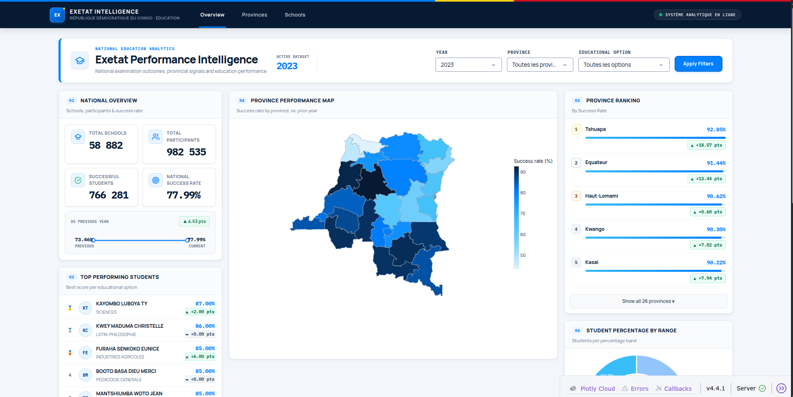
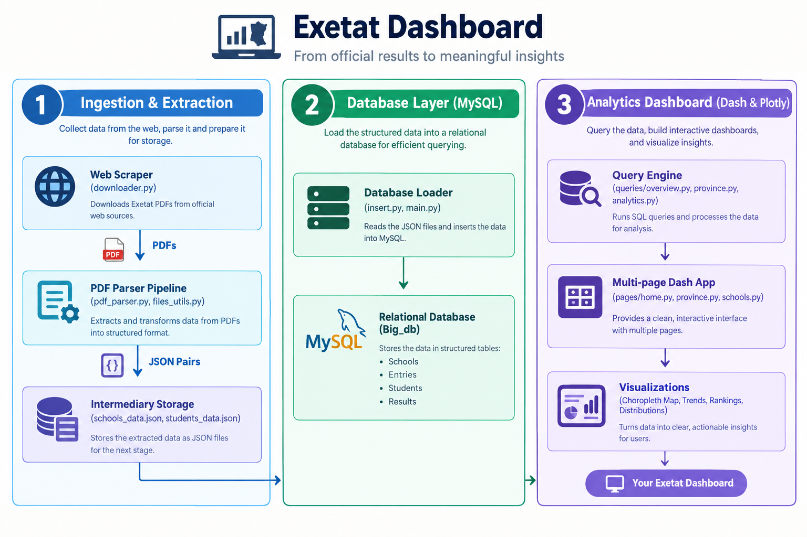
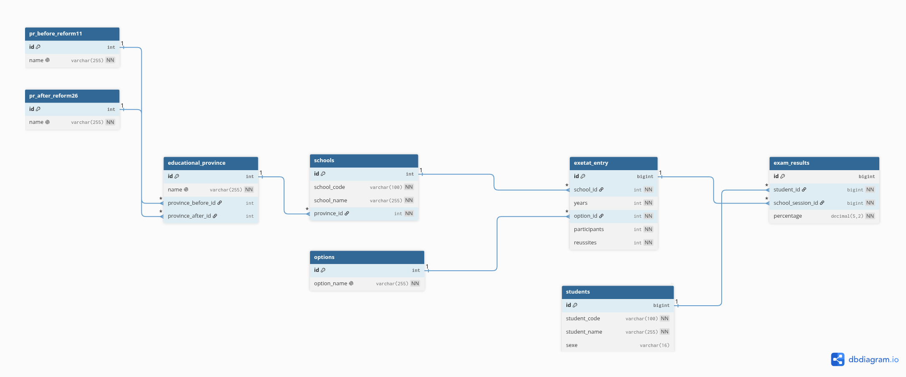

# Exetat — DRC National Exam Results Analysis


## Project Overview

EXETAT-analysis is an end-to-end data intelligence platform designed to improve access to and analysis of results from the Democratic Republic of the Congo's National State Examination **(*Examen d'État*).** The platform extracts tabular examination data from official government PDF reports, transforms and organizes it in a relational MySQL database, and presents the data through an interactive analytics dashboard.

The project's goal is to promote transparency in the DRC's education system by making **EXETAT results** more accessible, structured, and easier to analyze for education stakeholders, researchers, and other interested users.



> **Project status:** This project is under active development. Some data files and environment-specific configurations are not included in the repository, so additional setup may be required to reproduce the complete pipeline.Table of Contents

- [Features](#features)
- [Project Structure](#project-structure)
- [Technologies](#technologies)
- [Installation](#installation)
- [Configuration](#configuration)
- [Execution / Usage](#execution--usage)
- [Tests](#tests)
- [Data and privacy](#data-and-privacy)
- [Contributing](#contributing)
- [Contributors](#contributors)
- [Author](#author)
- [Change log](#change-log)
- [License](#license)

## Features

- **Web scraping and downloading:** Finds palmarès links on the DRC education results website and downloads PDF files.
- **PDF extraction:** Extracts school-level and student-level information from Exetat PDF palmarès documents and writes structured JSON output.
- **MySQL data loading:** Organizes province, option, school, exam-session, student, and exam-result data in a relational database.
- **National overview:** Summarizes schools, participants, successful candidates, and success rates.
- **Province analysis:** Compares provincial results and shows rankings, maps, distributions, and changes between years.
- **School and student rankings:** Supports school rankings and student result exploration within selected geographic and academic scopes.
- **Trend analysis:** Examines province performance across years and filters results by year and educational option.

## Project Structure

```text
Exetat/
├── database/
│   ├── db.py                 # MySQL connection configuration
│   ├── create_db.py          # Database/schema creation
│   ├── insert.py             # Data transformation and insertion helpers
│   └── main.py               # JSON-to-MySQL loading pipeline
├── pdf_parsing/
│   ├── main.py               # Batch PDF processing entry point
│   ├── pdf_parser.py         # PDF parsing logic
│   ├── pdf_helper.py         # Header/body extraction helpers
│   ├── files_utils.py        # File and processing utilities
│   └── check_missing.py      # Missing-data checks
├── exetat_dashboard/
│   ├── app.py                # Dash application entry point
│   ├── config.py             # Dashboard settings and constants
│   ├── pages/                # Overview, province, and school pages
│   ├── queries/              # Database queries and analytics
│   ├── figures/              # Charts, maps, rankings, and trend figures
│   ├── components/           # Reusable dashboard components
│   ├── assets/               # CSS and static assets
│   ├── data/                 # Province map GeoJSON data
│   └── tests/                # Dashboard tests
└── web-scraping/
    └── downloader.py         # Palmarès PDF link discovery and download
```



## Technologies

- [Python](https://www.python.org/) — application and data-processing code
- [Dash](https://dash.plotly.com/) — interactive web dashboard
- [Pandas](https://pandas.pydata.org/) — tabular data processing
- [MySQL](https://www.mysql.com/) — relational database
- [MySQL Connector/Python](https://dev.mysql.com/doc/connector-python/en/) — database connectivity
- [pdfplumber](https://github.com/jsvine/pdfplumber) and [PyPDF2](https://pypdf2.readthedocs.io/) — PDF text extraction and document handling
- [Requests](https://requests.readthedocs.io/) and [Beautiful Soup](https://www.crummy.com/software/BeautifulSoup/bs4/doc/) — web requests and HTML parsing
- [pytest](https://pytest.org/) — automated tests

## Installation

Follow these steps to set up the Exetat Analysis project locally using [`uv`](https://docs.astral.sh/uv/), a fast Python package and project manager.

### 1. Clone the repository

```bash
git clone https://github.com/Yvesmurh/exetat_analysis.git
cd exetat_analysis
```

### 2. Install uv

Install `uv` using the appropriate command for your operating system.

**Linux / macOS**

```bash
curl -LsSf https://astral.sh/uv/install.sh | sh
```

**Windows PowerShell**

```powershell
powershell -ExecutionPolicy ByPass -c "irm https://astral.sh/uv/install.ps1 | iex"
```

Verify the installation:

```bash
uv --version
```

### 3. Create the virtual environment and install dependencies

```bash
uv sync --locked
```

This creates the `.venv` virtual environment and installs the project dependencies using the existing lockfile.

If the project has a `pyproject.toml` but no `uv.lock` file yet, run:

```bash
uv sync
```

### 4. Activate the virtual environment (optional)

Activation is optional when using `uv run`, but useful if you want to execute commands directly in the environment.

**Linux / macOS**

```bash
source .venv/bin/activate
```

**Windows PowerShell**

```powershell
.venv\Scripts\Activate.ps1
```

### 5. Verify the setup

Check that Python is available in the project environment:

```bash
uv run python --version
```

To run a Python script, use:

```bash
uv run python src/my_script.py
```

Replace `your_script.py` with the actual script you want to execute.

## Configuration

### MySQL database

The database connection helper in `database/db.py` reads these environment variables:

| Variable           | Purpose           | Default in the current code                     |
| ------------------ | ----------------- | ----------------------------------------------- |
| `MYSQL_HOST`     | MySQL server host | `127.0.0.1`                                   |
| `MYSQL_USER`     | MySQL username    | `root`                                        |
| `MYSQL_PASSWORD` | MySQL password    | A development fallback is present in the source |
| `MYSQL_DATABASE` | Database name     | Your database_name                              |

Set your own credentials before running the project. For example, on Linux or macOS:

```bash
export MYSQL_HOST="127.0.0.1"
export MYSQL_USER="your_mysql_user"
export MYSQL_PASSWORD="your_secure_password"
export MYSQL_DATABASE="your_db_name"
```

On Windows PowerShell:

```powershell
$env:MYSQL_HOST = "127.0.0.1"
$env:MYSQL_USER = "your_mysql_user"
$env:MYSQL_PASSWORD = "your_secure_password"
$env:MYSQL_DATABASE = "Big_db"
```

Make sure MySQL is running and the configured database and required tables exist. The database creation and insertion scripts are under `database/`



## Execution / Usage

Commands below assume your terminal is in the extracted `Exetat_analysis` directory.

### Download palmarès PDFs

The scraper is located at `web-scraping/downloader.py`. It requests public palmarès pages from the DRC education results website, discovers PDF links, and downloads PDFs into a `downloads/` directory relative to the current working directory. Inspect the script and comply with the source website's terms and access rules before running it.

Once you get the Pdf_files you can get to the next section :

### Parse PDF palmarès documents

The PDF-processing entry point is:

```bash
uv run python -m pdf_parsing.main
```

Review `pdf_parsing/main.py` before running: it currently points to an expected input directory under `pdf_parsing/test_pdf/style_3/large_pdf` and writes JSON files under `pdf_parsing/json/style_3`. Create or update these directories and place your source PDFs in the configured input folder.

### Load parsed JSON data into MySQL

The database loading script is:

```bash
uv run python -m database.main
```

Before running, update the data directory in `database/main.py` to the location of your paired `*_schools_data.json` and `*_students_data.json` files. The current source contains a machine-specific absolute path, so it will not work on another computer without configuration changes. Ensure your database schema and credentials are correct before loading data.

### Run the dashboard

The dashboard uses package imports such as `exetat_dashboard.*`. Run it from the project directory so Python can resolve those imports:

```bash
uv run python -m exetat_dashboard.app
```

Open the local URL printed by Dash in your terminal. The dashboard code includes Overview, Provinces, and Schools pages. A working MySQL connection and populated database are needed for meaningful results.

## Data and privacy

for this project i have used public available data . it contain people's names , please only use for research purposes. in the future i will anonymalize all the name.

## Author

## Future Enhancements

- **Conversational AI assistant:** Develop a chatbot that allows users to explore examination statistics and retrieve insights through natural-language questions.
- **Geospatial analysis:** Extend geographic visualizations to support school-location analysis and regional comparisons.
- **Parent-oriented insights:** Explore privacy-conscious features that help parents understand school performance and make informed educational decisions.

Yves Murhabazi

Institution: ISBAT University, Faculty of Information and Communication Technology

Location: Kampala, Uganda
